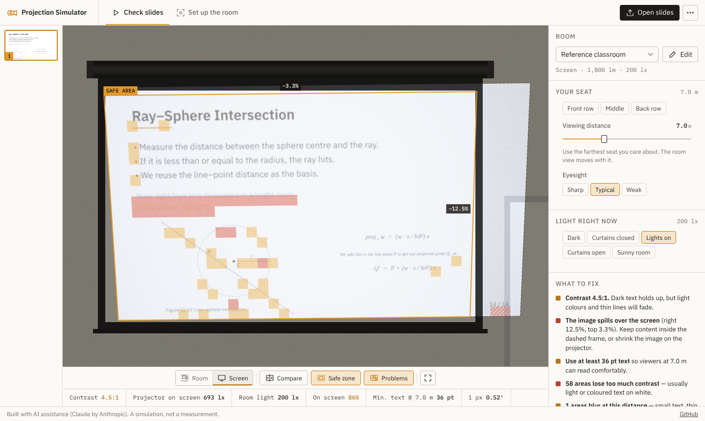

# Projection Simulator

**English** · [Türkçe](README.tr.md)

Preview how your slides will look on a classroom projector **before** you walk into the room: washed-out blacks in a lit room, colour cast from an ageing lamp, the picture spilling over the edge of the screen, keystone distortion, and what a student in the back row can still read.

> ### ▶ Live app: **[yavuzyunusoglu.github.io/projection-simulator](https://yavuzyunusoglu.github.io/projection-simulator/)**
>
> _Runs entirely in your browser. Files and photos are never uploaded._



---

## Why

Slides that look crisp on a laptop often fall apart on a classroom projector. A bright room lifts black to grey, light colours disappear, thin lines and small formulas blur from the back rows, and a misaligned projector cuts off the edge of every slide. This tool lets you see those problems in advance and fix the slides instead of the room.

## Features

The app has two modes: **Check slides** (what you use before every lesson: pick the room and your seat, see what to fix) and **Set up the room** (done once per classroom: calibrate, describe the room, save it).

- **Room light and contrast** — ambient light on the screen (with presets from *dark* to *sunny room*), its colour, projector brightness, lamp condition and native contrast combine into the effective on-screen contrast.
- **Colour cast** — projector colour temperature, or a colour matrix measured from a calibration photo.
- **Overflow and keystone** — image size, shift, keystone and tilt; the part that misses the screen lands on the wall and the whiteboard next to it.
- **Room layout** — projected onto a screen or straight onto a wall (in its measured colour), whiteboard and window left/right/none, a table or tall desk in front that hides the bottom of a low picture.
- **Safe zone** — the largest rectangle of your slide that is guaranteed to land on the screen, with how much is cut on each side.
- **Back-row readability** — viewing distance, eyesight, projector resolution and focus are modelled as blur, and the app recommends a minimum font size for the chosen seat.
- **Problem map** — tile-by-tile comparison of the original and the simulated slide highlights text that loses contrast, details that blur away and content that falls off the screen.
- **Compare slider** — drag between "on your laptop" and "projected".
- **Room, screen and photo views** — a virtual room seen from the chosen seat (it zooms with the viewing distance), a close-up of the picture, or **your slide inside the calibration photo of the real room**: wall texture, the projector's grey bands, the whiteboard and the desk are all real, and the photo is re-lit when you change the room light or projector settings.
- **Full screen** — button, double-click or <kbd>F</kbd>; a small toolbar lets you change slides, view, seat and overlays without leaving it.
- **Calibration from a photo**
  - *Test pattern:* show the built-in pattern on the projector (or download it as a PNG in any size and open it full screen on the device that is connected), photograph it from a seat, upload the photo. Coded markers and the pattern's aspect ratio are found automatically; the picture, whether there is a screen or a bare wall, the wall colour, contrast, room light and colour response are measured.
  - *Any photo:* use any picture of a slide on the projector together with the slide itself (or the one open in the app). Corners are estimated and can be adjusted with a magnifier.
- **Room profiles** — save rooms locally (IndexedDB), switch between them, export/import as JSON to share with colleagues.
- **Inputs** — PDF (via pdf.js), PowerPoint `.pptx` (built-in best-effort renderer), PNG/JPG/WebP.
- **English and Turkish**, light and dark theme (follows the system, can be overridden).
- **Works offline** as an installable PWA once it has been opened.

## Using it

1. Open the [live app](https://yavuzyunusoglu.github.io/projection-simulator/) and drop a PDF, PPTX or image onto it (or try the sample slide).
2. Pick a preset profile or set up your room in the right-hand panel: room light, projector, screen, position and audience.
3. Turn on **Safe zone** and **Problems**, and use **Compare** to see the difference from your laptop.
4. Follow the advice under **What to fix**.

### Calibrating your own projector

1. Switch to **Set up the room** → **Calibrate from a photo** → **Show test pattern** while the computer is connected to the projector. On a tablet or phone, use **Download** instead and open the PNG full screen from the photos app (no browser buttons on top of it).
2. From the middle of the room, take a photo that includes the whole picture and anything that spills onto the wall. No flash; keep the room lit as it will be during class.
3. Upload the photo. The orange points go on the corners of the white test pattern — not on the grey bands a projector may add around it. If a screen was found, the blue points mark its white surface; otherwise the surface is set to *Wall*. Then **Apply to simulation**.
4. Save the room. Its calibration photo is saved with it and powers the **Photo** view.

Tips: set the real **screen width** in the *Screen* section for correct font-size advice. Phone cameras white-balance automatically, so colour casts measured from photos are approximate; contrast and geometry are much more reliable.

### PowerPoint files

The built-in PPTX reader draws backgrounds, pictures, text with inherited placeholder styles, bullets, basic shapes, groups and tables. Charts, SmartArt, embedded media and EMF/WMF images are marked with a warning. For an exact preview, **export the deck as PDF** from PowerPoint and load the PDF.

## How the model works

The slide is treated as light falling on a virtual wall (metres, linear light):

- Projector illuminance on the screen: `E_white = lumens × lamp condition × uniformity / projected area`, black level `E_white / native contrast`.
- Room light adds `E_ambient` everywhere (screen, wall, whiteboard).
- Reflected luminance is `albedo × (E_projector + E_ambient)`; the result is shown relative to the screen's white (the eye adapts to the room), with partial chromatic adaptation.
- Geometry is a homography from slide coordinates to the wall; the safe zone is the largest axis-aligned rectangle inside the pre-image of the screen.
- Viewing distance: one slide pixel subtends `atan(pixel size / distance)`; eye resolution (~1 arcmin), resampling to the projector's native resolution and lens focus become a Gaussian blur.
- Calibration fits an affine colour model `measured = M·input + b` (plus a tone exponent from the grey ramp) to patches sampled through the detected homography.

It is a simplified physical model: use it as a guide, not as a measuring instrument.

## Running locally / hosting

No build step. Serve the folder with any static web server:

```sh
python3 -m http.server 8000
# open http://localhost:8000
```

Tests for the maths, colour fitting and marker detection (Node 18+):

```sh
node --test tests/*.test.mjs
```

### GitHub Pages

1. Push the repository to GitHub.
2. **Settings → Pages → Build and deployment → Source: Deploy from a branch**, choose the branch (e.g. `main`) and folder `/ (root)`.
3. The app will be published at `https://<user>.github.io/projection-simulator/`. All paths are relative, so it also works from any sub-folder.

## Project structure

```
index.html            app shell
css/                  design tokens and layout
js/sim/               photometry, homography, readability, WebGL renderer, analysis
js/calib/             test pattern, marker detection, colour fit, corner editor, photo-room layers
js/photoview.js       keeps the re-lightable room photo
js/loaders/           image, PDF, PPTX and sample slide
js/ui/                controls, stage toolbar & full screen, overlay, findings, profiles, slides
locales/              English and Turkish strings
vendor/               pdf.js 4.10.38, JSZip 3.10.1
fonts/                IBM Plex Sans / Mono
sw.js                 offline cache
tests/                node:test unit tests
```

## AI disclosure

This project was developed with the assistance of an AI model — **Claude, by Anthropic** — under the direction of the repository owner, who specified the requirements, supplied the reference photos and reviewed the result. The code, the physical model and the documentation were largely written by the AI. The model is a simplification of real optics and perception; please verify important decisions in the actual room. The same disclosure appears inside the app (footer and *About* dialog).

## Credits and licences

- [pdf.js](https://github.com/mozilla/pdf.js) — Apache License 2.0 (`vendor/pdfjs/LICENSE`)
- [JSZip](https://github.com/Stuk/jszip) — MIT (`vendor/jszip/LICENSE.md`)
- [IBM Plex](https://github.com/IBM/plex) — SIL Open Font License 1.1 (`fonts/OFL.txt`)

The application code is released under the [MIT License](LICENSE).
