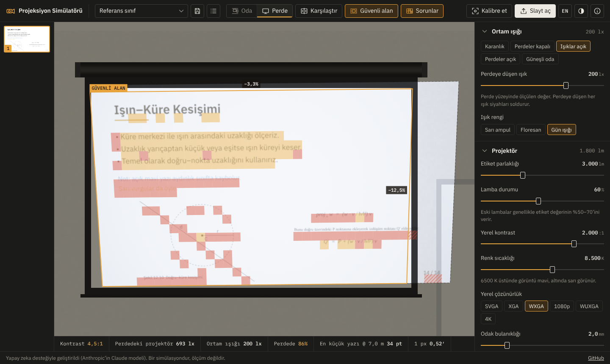

# Projeksiyon Simülatörü

[English](README.md) · **Türkçe**

Slaytlarının sınıftaki projektörde nasıl görüneceğini derse girmeden **önce** gör: aydınlık odada griye dönen siyahlar, eskiyen lambanın renk kayması, perdenin kenarından taşan görüntü, keystone bozulması ve arka sıradaki öğrencinin hâlâ neyi okuyabildiği.

> ### ▶ Uygulama: **[yavuzyunusoglu.github.io/projection-simulator](https://yavuzyunusoglu.github.io/projection-simulator/)**
>
> _Tamamen tarayıcında çalışır. Dosyalar ve fotoğraflar hiçbir yere yüklenmez._



---

## Neden

Bilgisayarda net görünen slaytlar sınıftaki projektörde çoğu zaman dağılır. Aydınlık oda siyahı griye çevirir, açık renkler kaybolur, ince çizgiler ve küçük formüller arka sıralardan bulanıklaşır, yanlış hizalanmış bir projektör her slaytın kenarını keser. Bu araç bu sorunları önceden görüp odayı değil slaytları düzeltmeni sağlar.

## Özellikler

- **Ortam ışığı ve kontrast** — perdeye düşen ışık (*karanlık*tan *güneşli oda*ya hazır ayarlarla), ışığın rengi, projektör parlaklığı, lamba durumu ve yerel kontrast birlikte perdedeki gerçek kontrastı belirler.
- **Renk kayması** — projektörün renk sıcaklığı ya da kalibrasyon fotoğrafından ölçülen renk matrisi.
- **Taşma ve keystone** — görüntü boyutu, kayma, keystone ve eğiklik; perdeyi ıskalayan kısım duvara ve yanındaki beyaz tahtaya düşer.
- **Güvenli alan** — slaytının perdeye düşeceği kesin olan en büyük dikdörtgen ve her kenardan ne kadar kesildiği.
- **Arka sıra okunabilirliği** — izleme mesafesi, görme keskinliği, projektör çözünürlüğü ve odak bulanıklık olarak modellenir; seçilen koltuk için en küçük yazı boyutu önerilir.
- **Sorun haritası** — orijinal ve simüle edilmiş slayt karo karo karşılaştırılır; kontrastını kaybeden yazılar, bulanıklaşan ayrıntılar ve perdenin dışına düşen içerik işaretlenir.
- **Karşılaştırma kaydırıcısı** — "bilgisayarında" ile "perdede" arasında sürükle.
- **Oda ve perde görünümleri** — perde, pencere ve beyaz tahtanın olduğu duvar görünümü ya da perdeye yakın görünüm.
- **Fotoğraftan kalibrasyon**
  - *Test deseni:* hazır deseni projektörde göster, oturduğun yerden fotoğrafını çek, yükle. Kodlu işaretler otomatik bulunur; yansıyan görüntü, perde kenarları, kontrast, ortam ışığı ve renk tepkisi ölçülür.
  - *Herhangi bir fotoğraf:* projektördeki bir slaytın herhangi bir fotoğrafını, slaytın kendisiyle (ya da uygulamada açık olanla) birlikte kullan. Köşeler tahmin edilir, büyüteçle ince ayar yapılabilir.
- **Oda profilleri** — odaları yerelde (IndexedDB) kaydet, aralarında geçiş yap, meslektaşlarınla paylaşmak için JSON olarak dışa/içe aktar.
- **Girdiler** — PDF (pdf.js ile), PowerPoint `.pptx` (yerleşik, elden geldiğince doğru çizici), PNG/JPG/WebP.
- **Türkçe ve İngilizce**, aydınlık ve karanlık tema (sisteme uyar, elle değiştirilebilir).
- Bir kez açıldıktan sonra **çevrimdışı çalışır**, uygulama olarak kurulabilir (PWA).

## Kullanım

1. [Uygulamayı](https://yavuzyunusoglu.github.io/projection-simulator/) aç ve bir PDF, PPTX ya da görsel bırak (veya örnek slaytı dene).
2. Hazır bir profil seç ya da sağ paneldeki ayarlarla odanı kur: ortam ışığı, projektör, perde, konum ve izleyici.
3. **Güvenli alan** ve **Sorunlar**ı aç, bilgisayarındaki halle farkı görmek için **Karşılaştır**ı kullan.
4. **Neyi düzeltmeli** bölümündeki önerileri uygula.

### Kendi projektörünü kalibre etmek

1. Bilgisayar projektöre bağlıyken **Kalibre et** → **Test deseni** → **Test desenini göster**.
2. Sınıfın ortasından, perdenin tamamını ve duvara taşan kısmı içeren bir fotoğraf çek. Flaş kullanma; oda ışığı ders sırasındaki gibi olsun.
3. Fotoğrafı yükle. Turuncu noktaları (yansıyan görüntü) ve mavi noktaları (perde yüzeyi) kontrol et, ardından **Simülasyona uygula**.
4. Sonucu o oda için profil olarak kaydet.

İpuçları: doğru yazı boyutu önerisi için *Perde* bölümünde gerçek **perde genişliğini** gir. Telefon kameraları beyaz dengesini otomatik ayarladığından fotoğraftan ölçülen renk kayması yaklaşıktır; kontrast ve geometri çok daha güvenilirdir.

### PowerPoint dosyaları

Yerleşik PPTX okuyucu arka planları, resimleri, yer tutucu stillerini devralan metinleri, madde işaretlerini, temel şekilleri, grupları ve tabloları çizer. Grafikler, SmartArt, gömülü medya ve EMF/WMF görseller uyarıyla işaretlenir. Birebir önizleme için sunumu PowerPoint’ten **PDF olarak dışa aktarıp** PDF’i yükle.

## Model nasıl çalışır

Slayt sanal bir duvara düşen ışık olarak ele alınır (metre, doğrusal ışık):

- Perdedeki projektör aydınlığı: `E_beyaz = lümen × lamba durumu × düzgünlük / görüntü alanı`, siyah seviyesi `E_beyaz / yerel kontrast`.
- Ortam ışığı her yere (perde, duvar, beyaz tahta) `E_ortam` ekler.
- Yansıyan parlaklık `yansıtma × (E_projektör + E_ortam)`; sonuç perdenin beyazına göre gösterilir (göz odaya uyum sağlar), kısmi renk uyumu uygulanır.
- Geometri slayttan duvara bir homografidir; güvenli alan, perdenin ters görüntüsünün içindeki en büyük eksen hizalı dikdörtgendir.
- İzleme mesafesi: bir slayt pikseli `atan(piksel boyu / mesafe)` açısı görür; göz çözünürlüğü (~1 yay dakikası), projektörün yerel çözünürlüğüne örnekleme ve odak Gauss bulanıklığına dönüştürülür.
- Kalibrasyon, bulunan homografi üzerinden örneklenen yamalara afin bir renk modeli `ölçülen = M·girdi + b` (ve gri rampadan bir ton üssü) uydurur.

Basitleştirilmiş bir fiziksel modeldir: ölçüm aracı değil, yol gösterici olarak kullan.

## Yerelde çalıştırma / yayınlama

Derleme adımı yok. Klasörü herhangi bir statik web sunucusuyla sun:

```sh
python3 -m http.server 8000
# http://localhost:8000 adresini aç
```

Matematik, renk uydurma ve işaret tespiti testleri (Node 18+):

```sh
node --test tests/*.test.mjs
```

### GitHub Pages

1. Depoyu GitHub’a gönder.
2. **Settings → Pages → Build and deployment → Source: Deploy from a branch**, dalı (ör. `main`) ve `/ (root)` klasörünü seç.
3. Uygulama `https://<kullanıcı>.github.io/projection-simulator/` adresinde yayınlanır. Tüm yollar göreli olduğundan herhangi bir alt klasörden de çalışır.

## Yapay zeka beyanı

Bu proje, gereksinimleri belirleyen, referans fotoğrafları sağlayan ve sonucu gözden geçiren depo sahibinin yönlendirmesiyle bir yapay zeka modelinin — **Anthropic’in geliştirdiği Claude** — yardımıyla geliştirilmiştir. Kodun, fiziksel modelin ve belgelerin büyük kısmı yapay zeka tarafından yazılmıştır. Model gerçek optik ve algının bir basitleştirmesidir; önemli kararları gerçek odada doğrula. Aynı beyan uygulamanın içinde de (altbilgi ve *Hakkında* penceresi) yer alır.

## Teşekkür ve lisanslar

- [pdf.js](https://github.com/mozilla/pdf.js) — Apache Lisansı 2.0 (`vendor/pdfjs/LICENSE`)
- [JSZip](https://github.com/Stuk/jszip) — MIT (`vendor/jszip/LICENSE.md`)
- [IBM Plex](https://github.com/IBM/plex) — SIL Open Font License 1.1 (`fonts/OFL.txt`)

Uygulama kodu [MIT Lisansı](LICENSE) ile yayınlanmıştır.
